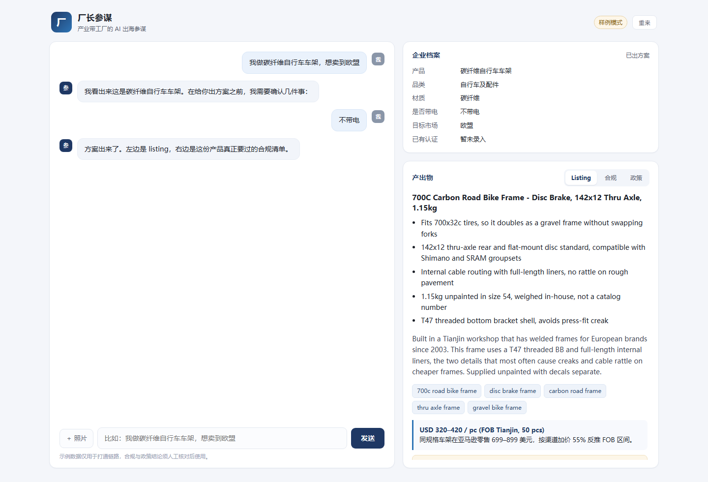

# 厂长参谋 · 产业带工厂的 AI 出海参谋

第二届全国人工智能应用创新大赛 通用赛道参赛作品。

一个记得住工厂的智能体：把产品、材质、认证、产能、目标市场记成一份**企业档案**，
据此判断能不能卖、写出能上架的 listing、顺手匹配可申报的政策。

- 零依赖：只用 Python 标准库，不需要 pip install
- 无密钥可跑：默认 MOCK 模式，全流程走通，适合先录 Demo
- 一条主链路 + 一条次链路：出海技能做全，政策技能做检索



---

## 1. 三十秒跑起来

```bash
python run.py
```

浏览器打开 http://127.0.0.1:8000。默认进入样例模式，不需要任何密钥。

想换个端口：`python run.py --port 8123`

---

## 2. 在 JoyCode 里怎么用

JoyCode 负责的是「写代码 + 调模型」，不是一个装应用的容器。推荐这样接：

1. 在 JoyCode 里打开本项目目录（或把整个仓库导入为工作区）。
2. 让它读 `README.md` 和 `app/agent.py`，先建立上下文。
3. 把大赛给的模型端点填进 `.env`（见下一节），在 JoyCode 的终端里跑 `python run.py`。
4. 要公网可访问，再在京东云上开一台最小规格云主机，把目录传上去跑同一条命令；或加一层 nginx 反代。

这样做的原因：编排逻辑（`agent.py`）是这个作品的核心，放在自己的代码里，
而不是藏在一个拖拽式 Bot 平台的黑盒里——评委问「它到底怎么决策的」时，你答得出来。

---

## 3. 接真实模型

复制 `.env.example` 为 `.env`：

```ini
LLM_BASE_URL=https://你的端点/v1
LLM_API_KEY=你的密钥
LLM_MODEL=你的模型名
VISION_MODEL=你的视觉模型名
```

要求是 **OpenAI 兼容**的 `POST /chat/completions`。配置齐全后自动退出样例模式，
右上角的「样例模式」标签会变成「已接入模型」。

调用量可以在 `GET /api/usage` 看到（调用次数、prompt / completion token、失败次数）——
答辩问「单次成本多少」时，直接拿这个数字除以测试次数。

DeepSeek 的完整接法（含「文本 DeepSeek + 视觉智谱」的混搭方案）见 `docs/接入DeepSeek.md`。

---

## 4. 目录结构

```
factory-advisor/
├── run.py                 启动入口
├── app/
│   ├── config.py          配置与 .env 加载，MOCK 判定
│   ├── llm.py             OpenAI 兼容客户端（标准库 urllib）
│   ├── store.py           会话与企业档案落盘（data/sessions, data/profiles）
│   ├── kb.py              规则卡与政策库检索
│   ├── prompts.py         全部提示词，改这里调优
│   ├── agent.py           编排状态机 ★核心
│   └── server.py          零依赖 HTTP 服务与 API
├── data/
│   ├── rules.json         合规规则卡（演示数据，见 data/README.md）
│   ├── policies.json      天津政策库（演示数据）
│   └── profiles/          运行后生成
├── web/                   工作台界面（原生 HTML/CSS/JS）
├── tests/smoke.py         端到端冒烟测试
└── tools/make_demo.py     一键造一个完整演示会话
```

---

## 5. 状态机

```
new ──上传照片/描述产品──▶ clarify ──回答追问──▶ ready ──生成──▶ done
                              │                              │
                              └──缺什么问什么，最多 3 个问题──┘
done ──「补贴/政策」──▶ 政策检索
     ──「重新生成」──▶ 再跑一次生成
```

追问只问三件事：**目标市场、是否带电、主要材质**。这三项直接决定命中哪几条合规规则，
其他字段都可以后补——不要一次问十个问题，用户会跑。

关键设计：`_missing()` 决定问什么，`_absorb_answers()` 负责把自然语言答案写回档案。
模型只负责理解，不负责决定流程——这是它和「套壳聊天」最大的区别。

---

## 6. API

| 方法 | 路径 | 说明 |
|---|---|---|
| POST | `/api/reset` | 新建会话 |
| GET | `/api/session?id=` | 读取会话（含消息、档案、产物） |
| POST | `/api/chat` | `{session_id, text}` |
| POST | `/api/upload` | `{session_id, data(base64), mime}` |
| POST | `/api/policy` | 按当前档案匹配政策 |
| GET | `/api/usage` | 调用量与 token 统计 |
| GET | `/api/health` | 健康检查 |

演示链接可以直接带会话：`/?sid=<session_id>&tab=compliance`，录屏时很好用。

---

## 7. 测试

```bash
python tests/smoke.py
```

覆盖：健康检查 → 建会话 → 描述产品 → 追问 → 生成 → 政策 → 档案落盘。全部应为 PASS。

---

## 8. 数据与边界（重要）

`data/` 下的两份 JSON 是**演示数据**，用于打通链路，不是合规依据。

- 每条规则都带 `verified: false`，界面上显示「待核对」角标。
- 政策库的金额、比例、截止日期一律写「以当年通知为准」，没有编造具体数字。

**提交作品前要做的事**：挑 8—12 条与你们案例品类相关的规则，打开 `source_url` 逐条核对，
核对通过的把 `verified` 改成 `true`。

对评委讲清楚这一点，比假装全都准确更值分。

---

## 9. 已知限制

- 样例模式下的 listing 是预置模板，只能用来打通链路和录屏，不代表真实生成质量。
- 政策匹配目前是关键词 + 地域 + 品类加权，没有做条件表达式解析（如「营收 < 2 亿」）。
- 未做多语言（只做英文）、未做询盘回复、未做设备诊断——这三项在 Roadmap 里。
- 单进程内存态 HTTP 服务，够一个人演示，不适合并发压测。
